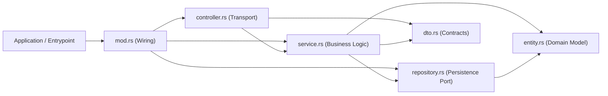

# Architecture Guide

This repository follows a **layered modular monolith** architecture. Every business domain lives in an isolated module with strict, unidirectional dependencies enforced automatically by automated architecture tests (`crates/core/tests/architecture.rs` and `crates/core/tests/integration.rs`).

## Dependency Direction



## Module Structure (`crates/core/src/modules/<domain>/`)

Every domain module is organized into six single-purpose files (each capped at 500 lines):

1. **`entity.rs`**: Pure domain data structures and invariants. Must never import `dto`, `repository`, `service`, or `controller`.
2. **`dto.rs`**: Request/response payloads and boundary validation (`validate()`). Must never import `repository`, `service`, or `controller`.
3. **`repository.rs`**: Persistence trait (`MathRepository`) and storage adapters (`InMemoryMathRepository`). Imports only `entity.rs`.
4. **`service.rs`**: Core business rules and orchestration. Coordinates `dto.rs`, `entity.rs`, and `repository.rs`. Must never import `controller.rs`.
5. **`controller.rs`**: Transport adapter (CLI, HTTP, RPC). Accepts raw inputs, invokes `service.rs`, and returns `dto.rs`. **Forbidden** from importing `repository.rs` directly.
6. **`mod.rs`**: Composition root that wires `InMemoryMathRepository` into `MathService` and `MathController`.

## Reference Example: `modules/math`

The included `crates/core/src/modules/math/` module demonstrates this pattern with an addition service that validates operand bounds, prevents integer overflow, and records calculation history.

## Adding a New Domain Module

1. Create `crates/core/src/modules/<domain>/` with the six standard files (`entity.rs`, `dto.rs`, `repository.rs`, `service.rs`, `controller.rs`, `mod.rs`).
2. Register `pub mod <domain>;` in `crates/core/src/modules/mod.rs`.
3. Add functional integration tests and layer boundary assertions in `crates/core/tests/integration.rs`, plus crate/config tripwires in `crates/core/tests/architecture.rs`.
4. Run `cargo xtask validate` to verify all eight gates pass.

## Monorepo Variant Architecture

When scaling into a multi-crate or multi-service workspace, adopt the Cargo workspace monorepo layout:

```text
.
├── apps/                         # Independently deployable services / binaries
│   ├── server/                   # Backend HTTP/RPC server daemon
│   └── cli/                      # Command-line client binary
├── crates/                       # Shared libraries and internal utilities
│   ├── core/                     # Domain invariants, entities, and business rules
│   ├── protocol/                 # Versioned DTOs and serialization contracts
│   └── xtask/                    # Sovereign automation and validation engine
├── Cargo.toml                    # Root workspace manifest with [workspace.dependencies]
└── Cargo.lock                    # Single committed lockfile
```

- **Workspace Dependencies**: Centralize versions in the root `[workspace.dependencies]` table; member crates import via `dep_name.workspace = true`.
- **Validation Parity**: Root `cargo xtask validate` executes lint, typecheck, unit, and architecture checks across all workspace members.

## Workspace Lint & MSRV Invariants

- **Pinned MSRV**: `[workspace.package]` enforces `rust-version = "1.85"` across all workspace crates.
- **Immutable Safety & Clippy Policy**: `[workspace.lints]` forbids `unsafe_code` (`unsafe_code = "forbid"`) and enforces strict Rust/Clippy rules (`missing_docs`, `missing_debug_implementations`, `unreachable_pub`, `unwrap_used`, `as_conversions`, `print_stdout`, `print_stderr`, `allow_attributes`, and `clippy.toml` with `max-fn-params-bools = 0`).
- **CI Execution & Tripwires**: `lint` runs `cargo clippy --workspace --all-targets --all-features -- -D warnings`, and `crates/core/tests/architecture.rs` verifies that `Cargo.toml` and `clippy.toml` lint settings are never removed or weakened.

## Public API Contracts

- **Typed Errors**: Domain failures use a `#[non_exhaustive]` enum implementing `Display` and `std::error::Error`, never string errors.
- **Common Traits**: Public value types derive `Debug`, `Clone`, `Copy`, `PartialEq`, `Eq`, and `Hash`; shared collaborators are `Send + Sync`.
- **Compile-Time Locks**: `crates/core/tests/architecture.rs` asserts these trait bounds at compile time, so removing one fails the build.

## Inter-Constellation Boundary

- **Decoupled Integration**: Sibling constellations never import one another as Cargo dependencies; all cross-constellation integration occurs strictly over wire protocols (REST, WebSocket/WSS, gRPC).
