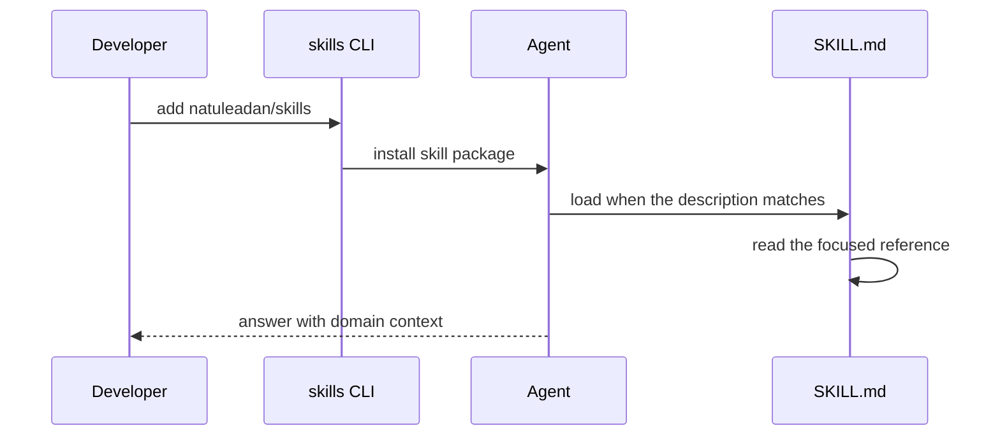

<h1 align="center">Natuleadan Skills</h1>

<strong>Domain context for AI coding agents, packaged as installable skills</strong>

  
  
  
  
   
  

## 1. What is Natuleadan Skills?

A collection of agent skills for AI coding agents. Each skill is a
self-contained package of instructions and reference notes: install it once and
the agent knows the conventions of that domain instead of inventing them.

17 skills: one platform skill and sixteen industry AI tool skills.

### What is inside

Each skill is a short guide, a set of focused references and a script stub ready
for future automation. The stubs name the commands planned for each area, so an
agent knows what exists before it writes code.

## 2. Why Natuleadan Skills?

Coding agents are strong at code and weak at context. They guess conventions,
miss constraints and repeat the same research in every session.

- **One platform skill, not one per product.** The platform surface lives in four
  references, so the catalog stays stable as products evolve.
- **Sixteen industries, one format.** Healthcare, agriculture, security and the
  rest share the same structure, so an agent learns the pattern once.
- **Provider-agnostic.** Industry skills describe the work, not a vendor; they
  run with any compatible backend.
- **One command to install.** No build step, no runtime, no lock-in.

## 3. Highlights

- **17 skills, each with references and a script stub.**
- **Platform in one place:** APIs, declarative services, operations and data.
- **Industry depth:** clinical, biology, agriculture, energy, manufacturing,
  logistics, environment, education, commerce, entertainment, technology,
  construction, security, space and government.
- **Progressive disclosure:** a short `SKILL.md` and focused references, so the
  agent loads only what the task needs.
- **Scripts included:** every skill ships a Node stub; run
  `pnpm skill <name> --help` to see its commands.
- **Apache-2.0.**

## 4. Quick start

1. Install the collection: `pnpx skills add natuleadan/skills`.
2. Install one skill: `pnpx skills add natuleadan/skills --skill natuleadan-skills`.
3. Open your agent and ask a platform or industry question.

The agent picks the skill from its description; you do not wire anything else.

## 5. Use cases

- **Platform work:** call agent, robot and toolset APIs, declare a service,
  operate infrastructure or query relational and vector data.
- **Industry work:** give an agent the vocabulary and constraints of a regulated
  or specialized area before it writes code.
- **Agent setup:** bootstrap a coding agent with a consistent skill library
  instead of prompting the same context by hand.

## 6. How it works

Each skill has a `SKILL.md` with the trigger description and a `references/`
folder with the detail. The agent loads the entry point first and opens a
reference only when the task needs it.

## 7. Status and roadmap

- 17 skills are available today.
- The platform references are stubs while the platform definition settles.
- Industry skills expand as each area gains real content.
- Next: fill the platform references and deepen the industry notes.

## 8. Documentation

- [Skills Index](SKILLS.md): the full catalog with descriptions.
- [Contributing](CONTRIBUTING.md): format, validation and commit rules.
- [Agent Guide](AGENTS.md): commands, structure and release flow.
- [Security](SECURITY.md): how to report a vulnerability.

## 9. Ecosystem

Natuleadan Skills follows the Agent Skills format and works with any compatible
client. It is part of the [natuleadan](https://github.com/natuleadan)
organization and complements the platform repositories: the skills teach an
agent how to use the platform, the repositories implement it.

## 10. Community

  
  

Questions, ideas and bugs: open an issue in this repository.

## 11. Contributing

Read [CONTRIBUTING.md](CONTRIBUTING.md) for the skill format and
[AGENTS.md](AGENTS.md) for the commands. Every change goes through a pull
request, passes `pnpm validate` and uses a conventional commit with an allowed
scope.

## 12. License

This project is released under the Apache License 2.0. Copyright NATULEADAN
SAS BIC, 2023 - Present.

The full terms are in [LICENSE](LICENSE). Attribution is in
[NOTICE](NOTICE), and the licenses of the development dependencies are in
[ThirdPartyNotices.txt](ThirdPartyNotices.txt).

---

## Star History

<a href="https://www.star-history.com/#natuleadan/skills&Date">
  <picture>
    <source media="(prefers-color-scheme: dark)" srcset="https://api.star-history.com/image?repos=natuleadan/skills&type=date&theme=dark" />
    <source media="(prefers-color-scheme: light)" srcset="https://api.star-history.com/image?repos=natuleadan/skills&type=date&theme=light" />
    
  </picture>
</a>
