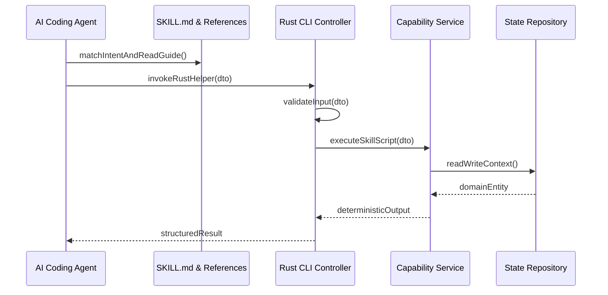

<p align="center"></p>

<h1 align="center">Natuleadan Skills</h1>
<p align="center"><strong>Installable domain skills and native Rust execution scripts for AI coding agents</strong></p>

<p align="center">
  
  
  
  
  <a href="LICENSE"></a>
  <a href="https://natuleadan.com"></a>
</p>

## 1. What is Natuleadan Skills?

Natuleadan Skills is being built as a sovereign catalog of installable AI agent skills (`SKILL.md`), focused domain references, and **native Rust executable scripts** organized around the **seven Natuleadan constellations** (`Orion`, `Andromeda`, `Aurora`, `Pleaides`, `Pulsar`, `Caelum`, and `Lyra`) in a pure-Cargo workspace. Each planned skill will give coding agents explicit constellation conventions paired with fast, type-safe Rust CLI utilities, eliminating Node.js and Python runtime dependencies.

### What is inside

The repository pairs progressive-disclosure skill documentation with `skills-core`, a layered six-file modular Rust workspace (`entity`, `dto`, `repository`, `service`, `controller`, `mod`) and `crates/xtask` automation governed by eight native validation gates.

> **Current scope:** This release ships the native validation harness and the six-file modular reference domain (`modules/math`). The skill registry, `SKILL.md` catalog and native helper commands are planned milestones, not shipped capabilities.

## 2. Why Natuleadan Skills?

AI coding agents excel at syntax but struggle with domain constraints and frequently rely on fragile, unpinned Node.js or Python helper scripts that fail across environments.

- **Skills + native Rust scripts**: Each planned skill will pair concise `SKILL.md` guidance with compiled, memory-safe Rust utilities instead of brittle interpreted scripts.
- **Progressive context disclosure**: Agents load only the targeted reference or subcommand needed for the task, keeping context windows lean.
- **Strict modular contracts**: Domain models, DTO validation, and execution controllers are isolated and verified by architecture tripwires.
- **Zero formatter drift**: Formatters are excluded from hooks and CI so diffs remain focused on logic and capability definitions.

## 3. Highlights

- **100% Pure native Rust**: Zero `package.json`, zero `pnpm`, and zero Python runtime requirements.
- **Layered modular architecture**: Clean domain separation (`entity`, `dto`, `repository`, `service`, `controller`, `mod`).
- **Eight standardized validation gates**: Static linting, typechecking, unit tests, architecture tripwires, 3-day cooldown, hygiene, notices, and SemVer checks.
- **Supply-chain hardening**: Enforced 3-day dependency publish cooldown (`resolver.min-publish-age="3 days"`), CodeQL, and SBOM artifacts.
- **Apache-2.0 licensed**: Clear commercial terms with automated `ThirdPartyNotices.txt` verification.

## 4. Quick Start

Ensure Rust `1.85+` (Rust 2024 edition / stable, matching `rust-version = "1.85"`) is installed:

```bash
# Clone the repository
git clone https://github.com/natuleadan/skills.git
cd skills

# Activate local hooks
git config core.hooksPath .githooks

# Run the complete 8-gate native validation suite
cargo xtask validate
```

Other native `xtask` operations:

```bash
cargo xtask notices          # Regenerate ThirdPartyNotices.txt from cargo metadata
cargo xtask release --check  # Verify Cargo.toml version and CHANGELOG parity
cargo test --workspace       # Execute unit, integration, and architecture tests
```

## 5. Use Cases

- **Agent context & tooling**: Equip coding agents with verified domain conventions and deterministic Rust helper commands.
- **Platform & industry workflows**: Package cross-industry operational constraints and validation utilities under one consistent contract.
- **Regulated environments**: Guarantee every helper script obeys 3-day supply-chain cooldowns and full license attribution.

## 6. How It Works



Once available, an agent will match a task to a `SKILL.md` guide, read focused references on demand, and invoke compiled Rust utilities through `controller` and `service` layers with strict `dto` validation.

## 7. Status and Roadmap

- **Status**: Initial foundation — validation harness and modular reference skeleton in place; skill catalog and native scripts in progress.
- **Milestone 1**: Core skill registry schema, `SKILL.md` loader, and initial native Rust helper commands.
- **Milestone 2**: Platform and industry domain skill packs with compiled CLI utilities.
- **Milestone 3**: Decoupled CLI and wire-protocol capability discovery for Pulsar and sibling constellations.

## 8. Repository Layout & Validation Gates

```text
.
├── .cargo/                  # Cargo configuration and 3-day cooldown resolver
├── .githooks/               # Versioned commit-msg, pre-commit, and pre-push hooks
├── .github/                 # Issue templates, dependabot config, and CI workflows
├── crates/
│   ├── core/                # Core skills library & helpers (src/modules/math, lib.rs)
│   │   └── tests/           # integration.rs and immutable architecture.rs tripwires
│   └── xtask/               # Pure-Rust automation CLI (cargo xtask <cmd>)
├── .env.example             # Environment contract template (copy to git-ignored .env)
├── Cargo.toml               # Workspace manifest (rust-version = "1.85", [workspace.lints])
├── clippy.toml              # Strict Clippy policy (max-fn-params-bools = 0)
├── ARCHITECTURE.md          # Modular domain architecture specifications
├── AGENTS.md                # Autonomous AI agent operating guidelines
├── CONTRIBUTING.md          # Contribution workflow and commit grammar
├── SECURITY.md              # Supply-chain policies and vulnerability reporting
├── LICENSE                  # Apache-2.0 License
├── NOTICE                   # Copyright (c) 2026 Natuleadan.
└── ThirdPartyNotices.txt    # Automated third-party license inventory
```

| Gate | Command | Purpose |
| :--- | :--- | :--- |
| `lint` | `cargo clippy --workspace --all-targets --all-features -- -D warnings` + `cargo doc -D warnings` | Strict zero-warning static analysis and rustdoc checks |
| `typecheck` | `cargo check --workspace --all-targets` | Workspace type verification |
| `unit tests` | `cargo test --workspace --lib` + `--doc` | Library unit tests and runnable doc examples |
| `integration and architecture tests` | `cargo test --workspace --test '*'` | Integration flows and layer tripwires |
| `cooldown` | `cargo --config 'resolver.min-publish-age="3 days"'` | 3-day package release cooldown |
| `hygiene` | `crates/xtask/src/hygiene.rs` | 500-line limit, anti-leak, and syntax checks |
| `notices` | `crates/xtask/src/notices.rs` | License inventory parity check |
| `release` | `crates/xtask/src/release.rs` | SemVer and CHANGELOG consistency |

## 9. Documentation

- [ARCHITECTURE.md](ARCHITECTURE.md): Modular architecture, layer boundaries, and design invariants.
- [CONTRIBUTING.md](CONTRIBUTING.md): Issue-first contribution policy, PR workflow, and commit grammar.
- [SECURITY.md](SECURITY.md): Vulnerability disclosure procedures and supply-chain controls.
- [AGENTS.md](AGENTS.md): Machine-facing instructions for autonomous engineering.

## 10. Ecosystem & Community

Natuleadan Skills provides installable agent knowledge and Rust helper scripts organized around all seven Natuleadan constellations: Orion, Andromeda, Aurora, Pleaides, Pulsar, Caelum, and Lyra.

<p align="left">
  <a href="https://github.com/natuleadan"></a>
  <a href="https://github.com/leojara95"></a>
</p>

Bug reports and feature proposals are tracked via structured GitHub Issues.

## 11. Contributing

External pull requests are restricted to maintainers (`collaborators_only`). Please open an issue describing your bug or proposal. See [CONTRIBUTING.md](CONTRIBUTING.md) for details.

## 12. License & Star History

This project is licensed under the Apache License 2.0. Copyright (c) 2026 Natuleadan.

Terms are in [LICENSE](LICENSE), attribution in [NOTICE](NOTICE), and third-party dependency notices in [ThirdPartyNotices.txt](ThirdPartyNotices.txt).

<a href="https://www.star-history.com/#natuleadan/skills&Date">
  <picture>
    <source media="(prefers-color-scheme: dark)" srcset="https://api.star-history.com/image?repos=natuleadan/skills&type=date&theme=dark" />
    <source media="(prefers-color-scheme: light)" srcset="https://api.star-history.com/image?repos=natuleadan/skills&type=date&theme=light" />
    
  </picture>
</a>
