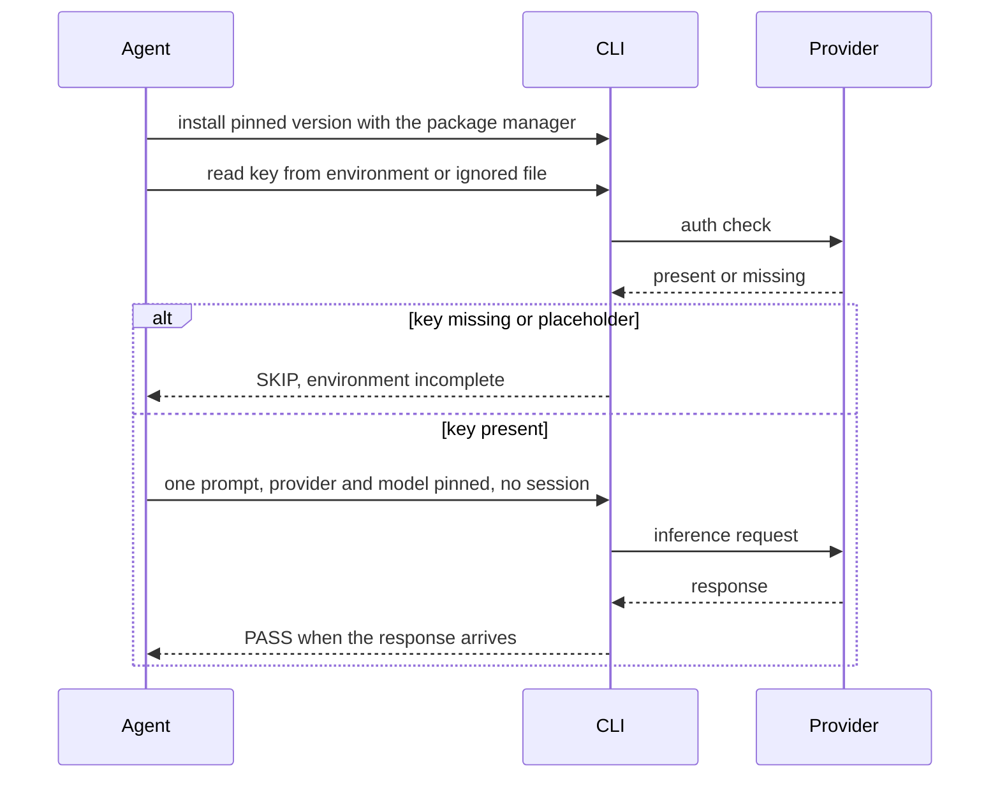

# Agent Runtime

How to install a coding agent, authenticate it against a provider, and prove
that its loop actually runs. Commands are inline suggestions.

## What it is

A coding agent is a CLI that takes a prompt, calls a model, may call tools,
and returns a result. Installing it has three parts: the binary, the
credentials, and a loop test that exercises both.

## Install

Install through the package manager the workstation already uses, with the
version pinned: `pnpm add -g <package>@<version>`. A global pnpm install
writes into the pnpm home, which is already on the path from the workstation
block. Do not use `npm`; it reintroduces a second package manager and a
second `node`.

If an agent is already installed by another method, check its version before
replacing it. Two installations of the same binary resolve in path order, and
the wrong one wins silently.

## Credentials

- The provider key comes from the environment or from an ignored env file,
  never from the repository.
- Reference the key by name in output. Never print its value, not even a
  prefix.
- One key per environment: development, test and production never share a
  secret.
- A file with a placeholder is a template, not a credential.

## The placeholder trap

An auth check may report `ready` when a key is merely present, even a
placeholder. Presence is not validity. Treat a known placeholder as absent
and emit `SKIP`; never report `PASS` on the strength of an auth check alone.

The only proof that the credential works is a real call through the
provider.

## The loop

The loop is one real prompt through the pinned provider and model:

- Pass the provider explicitly; model catalogs live per provider, and the
  same name can exist in two catalogs with different availability.
- Disable session persistence for the test so it leaves no state.
- Bound it with a timeout; a hung loop is a failure, not a wait.
- Assert on the response, not on the exit code alone.

When the key is missing, the loop is `SKIP`, not `FAIL`: the environment is
incomplete, not broken. A `FAIL` is reserved for a key that is present and
still cannot produce a response.

## Failure modes

- **Auth says ready, inference fails.** Placeholder key, expired key, or the
  wrong provider. Test the call, not the check.
- **Wrong catalog.** The same model name under two providers is two different
  catalogs; a 402 or 429 is a quota or billing signal, not a bug.
- **Agent blocks its own tools.** A filesystem guard can make an agent safe
  and useless at once. Decide which one is being bought before enabling it.
- **State leaks between runs.** A session flag left on makes the next test
  depend on the previous one.

## Flow

