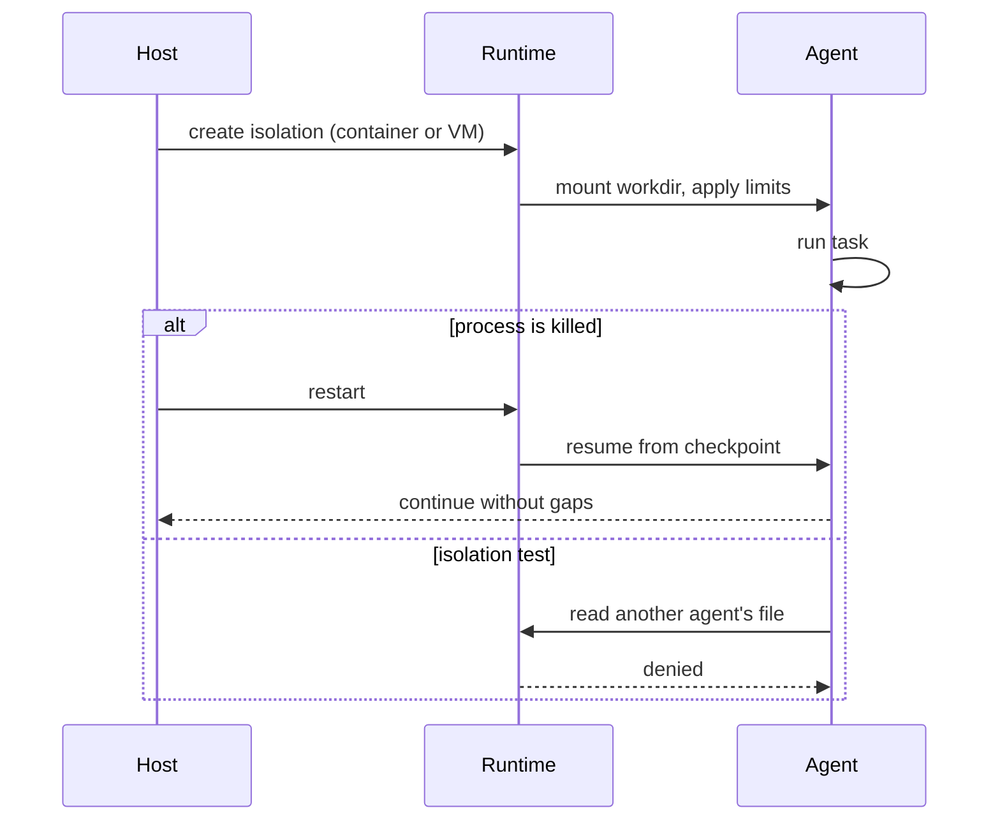

# Sandbox

How to isolate an autonomous agent, and what each boundary actually buys.

## Two levels

**Containers** share the host kernel. They are cheap, fast to start, and
enough for filesystem isolation between agents, per-agent CPU and memory
limits, and a distinct hostname. They are not a security boundary for
untrusted code.

**One VM per agent** gives a separate kernel. Use it when the agent must not
be able to reach the host at all, and budget the memory: each VM carries a
full guest.

Choose by the threat, not by convenience. A container for a trusted agent
that must not read another agent's files is correct. A container for
adversarial code is not.

## What to limit

- Memory and CPU per agent, so one runaway does not starve the host.
- A working directory mounted per agent; nothing shared unless intended.
- Network egress: a narrow allow-list is easier to reason about than a
  blanket deny.
- A restart policy for anything that must stay up.

Verify the isolation, do not assume it: from one agent, try to read another
agent's file and confirm it fails. A mount mistake is invisible until tested.

## Durability

Decide explicitly what happens when the process dies:

- **Ephemeral** runs re-execute from the start. Simple, and fine for
  one-shot tasks.
- **Durable** runs checkpoint to storage and resume after a hard kill. Use it
  when work is long and expensive, and prove it: kill the process mid-run and
  confirm the log continues without gaps or duplicates.

A durable run that has never been kill-tested is an assumption, not a
guarantee.

## The guard trade-off

A guard that blocks the filesystem makes an agent safe and useless at the
same time. Decide which one is being bought before enabling it, and document
the trade-off next to the configuration.

## Flow

