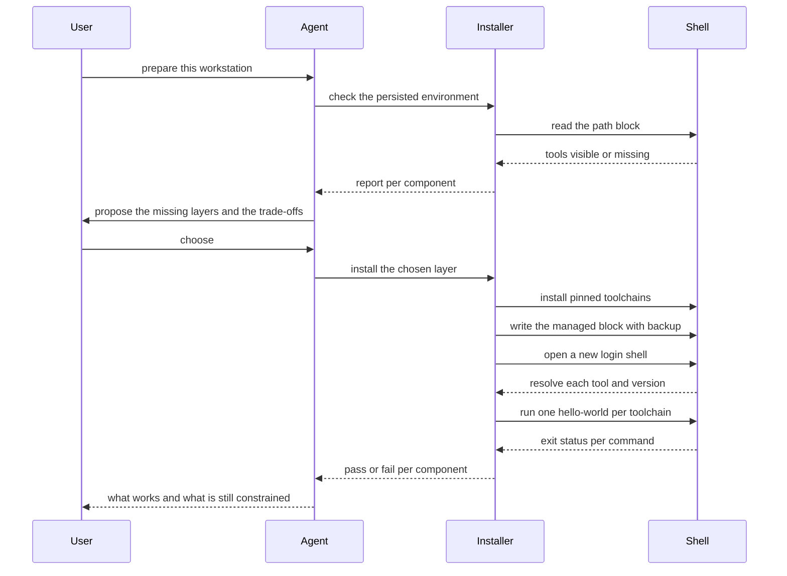

# Workstation

How to decide and build a development workstation for AI agents: the layers,
the trade-offs, and the recipe to replicate it. Commands are inline
suggestions; the reader decides.

## Layers

An agent workstation needs five layers, in this order:

1. **Toolchains** - runtimes that compile and execute code.
2. **Containers** - disposable, reproducible execution.
3. **On-device models** - small classifiers that run locally, without a network.
4. **Local LLM** - optional, for offline inference and privacy.
5. **Agent runtime and sandbox** - the coding agent, and the limits around it.

Install the lower layers first. Every higher layer depends on them.

## Contract for an installer

- One `PASS`/`FAIL`/`SKIP` line per step, then a summary.
- Exit `0` when every executed step passes or skips, `1` on any failure,
  `2` on bad usage or an unsupported platform.
- Idempotent: a satisfied step prints `SKIP`.
- No `sudo`: everything installs under the home directory.
- Versions are pinned at the top, in one place.
- Secrets are read from the environment or an ignored file and never printed.

## Platform detection

- macOS (`arm64` and `amd64`), Linux, and WSL2 (detected through
  `/proc/version`, then treated as Linux).
- Native Windows is rejected with guidance to use WSL2.
- **Rosetta:** a translated terminal reports `x86_64` on an arm64 Mac. Read
  `sysctl -in sysctl.proc_translated`; when it returns `1`, use arm64 binaries.
- **Prerequisites:** `curl`, `tar` and `gzip` must exist before anything is
  touched. Fail early with a clear message instead of halfway.

## Package management

Prefer `pnpm` and its derivatives. Avoid `npm` and `npx`.

The reason is reproducibility, not taste: `npm` writes a flat `node_modules`
and a lockfile whose resolution varies across machines, and it runs install
scripts silently. `pnpm` uses a content-addressed store, a lockfile that
resolves identically everywhere, and blocks build scripts until approved
with `pnpm approve-builds <package>`. In pnpm 12 the configuration lives in
`pnpm-workspace.yaml` under `allowBuilds`, not in `.npmrc`.

**npm guard:** if `npm` resolves in the path, the environment is no longer
reproducible. Treat its presence as a failure and resolve which toolchain
brought it in. `node` must come from the pnpm runtime.

## Toolchains

Install every toolchain at user level: no `sudo`, no writes to `/usr/local`.

- **pnpm** - official installer with the version pinned:
  `curl -fsSL https://get.pnpm.io/install.sh | env PNPM_VERSION=<v> sh -s`.
- **Node** - through the pnpm runtime:
  `pnpm runtime set node <v> --global`. It ships `node` only, with no `npm`,
  `npx` or `corepack`; that is intended for this setup.
- **uv** - official installer with the version pinned:
  `curl -LsSf https://astral.sh/uv/install.sh | env UV_VERSION=<v> sh -s`.
- **Python** - `uv python install <v>`, resolved with `uv python find <v>`.
- **Go** - download the tarball for the detected OS and architecture, verify
  its `sha256` against the matching filename in `https://go.dev/dl/?mode=json`,
  then extract under `~/.local/go`. Binaries from `go install` land in
  `~/go/bin`.
- **Rust** - `rustup-init -y --profile minimal --no-modify-path`, then
  `rustup toolchain install <v>` and `rustup default <v>`. The
  `--no-modify-path` flag matters: path management belongs to this recipe,
  not to rustup.

After changing the path, open a new terminal. GUI applications do not read
the shell profile, so an agent launched from a GUI may miss every tool.

## Persist the path

Installing is not enough: a tool that is not on the path of a **new**
terminal does not exist.

1. Detect the login shell and its rc: `~/.zshrc`, `~/.bashrc` or `~/.profile`.
2. Write a delimited block between `# >>> workstation >>>` and
   `# <<< workstation <<<`.
3. Include the pnpm home and its `bin`, `~/.local/bin`, the Go installation
   (local or `/usr/local/go`), `~/go/bin` and `~/.cargo/bin`. Guard every
   entry so a path is never added twice.
4. Back up the rc file before writing.
5. If the block already matches, do nothing: the operation is idempotent.
6. When checking, evaluate the **persisted** block, not the current process.
   A check that reads the current shell reports false failures.

## Verify in a new shell

The only honest verification runs in a login shell, the way a new terminal
starts: `zsh -lic "<command>"` or `bash -lc "<command>"`. For each tool,
assert it resolves and prints the pinned version. Then run one functional
hello-world per toolchain and mark `PASS` only when the command exits zero.

## Containers

Choose **Colima** over Docker Desktop or OrbStack when the machine is modest
and the goal is a Linux kernel you control. Colima runs a lightweight Linux
VM through Lima and exposes the daemon socket; it needs no GUI, no license
and no privileged daemon. Docker Desktop is heavier and bundles a GUI an
agent cannot use; OrbStack is fast but ties the setup to one vendor.

Notes before choosing Colima: it requires its own VM manager (`limactl`)
alongside the CLI; macOS needs the quarantine attribute cleared after
downloading binaries; it looks for `limactl` on the path even in
non-interactive sessions; and switching the container runtime of an existing
profile requires deleting the instance data first.

Kubernetes is optional. A single-node cluster proves manifest work but costs
memory and disk. Treat it as a per-project choice, not a default.

On Windows, the native shell does not run these scripts. Use WSL2 with Ubuntu
and follow the Linux path.

## On-device models

Two failure modes decide the architecture, not the model quality.

**Native addons are tied to the OS version.** A prebuilt Node addon compiled
for a newer macOS refuses to load on an older one, even with the same CPU.
Pure JavaScript and WebAssembly packages do not have this problem.

**A Linux VM is the escape hatch.** The same packages usually ship Linux
shared libraries that load in an Ubuntu guest with a current glibc. When a
model fails only on the host, test it inside the container VM before
concluding the model is broken.

Two habits prevent false negatives: some native addons crash during teardown
*after* a correct inference, so have the demo print a completion marker and
accept it; and pin versions that resolve, because a published release can
still have a missing tarball.

## Local LLM

Choose `llama.cpp` for direct control and GGUF coverage, and accept that you
manage binaries and weights yourself. Choose a packaged runtime for
convenience and a daemon, at the cost of control.

Compute placement matters more than flags:

- **GPU** is faster but depends on a current graphics stack. On older macOS
  releases the prebuilt binary aborts before inference; building from source
  restores it.
- **CPU-only** is slower and predictable. Zero layers offloaded is the
  reliable fallback: `-ngl 0`.
- **Model size** dominates throughput. A sub-billion-parameter model on CPU
  is interactive; a multi-billion one is not, regardless of flags.

Expose the server through the OpenAI-compatible endpoint so clients switch
between local and remote without code changes.

## Agent runtime

The coding agent, its provider authentication and the loop that proves it
works are documented in `references/agent-runtime.md`.

## Sandboxing

Container isolation, one VM per agent, resource limits and durable
checkpoints are documented in `references/sandbox.md`.

## Platform matrix

| Platform | Position | Notes |
|---|---|---|
| macOS, Apple Silicon | Good default | Native addons track the OS version |
| macOS, Intel | Supported | Same constraints, slower inference |
| Linux | Best fit for containers and native addons | Current glibc loads most prebuilts |
| Windows (native) | Not supported for these scripts | Use WSL2 with Ubuntu |
| Windows (WSL2) | Recommended | Treat as Linux; the VM boundary is free |

## Decision table

| Need | Choose | Because |
|---|---|---|
| Reproducible installs | `pnpm` | Lockfile resolves identically; scripts are explicit |
| No root access | User-level installs | No system writes, no PATH hijack surface |
| Containers without a GUI | Colima | Small, scriptable, no license |
| Model fails only on the host | Linux VM | Native addon is bound to the OS version |
| GPU unavailable or unstable | CPU-only inference | Predictable output beats peak speed |
| Agents must not reach the host | One VM per agent | Separate kernel, not just a namespace |
| Long-running agent work | Durable checkpoints | Kill-test proves resume |
| Windows workstation | WSL2 Ubuntu | Native shell is not supported |

## Limits

- A recent macOS is a hard requirement for some prebuilt native binaries.
- A missing build toolchain blocks source builds; prefer prebuilts or install
  the toolchain deliberately.
- Containers are not a security boundary for untrusted code; use a VM when
  the code is adversarial.
- A pinned version ages. Re-verify the stack before a course or a recording.

## Flow

